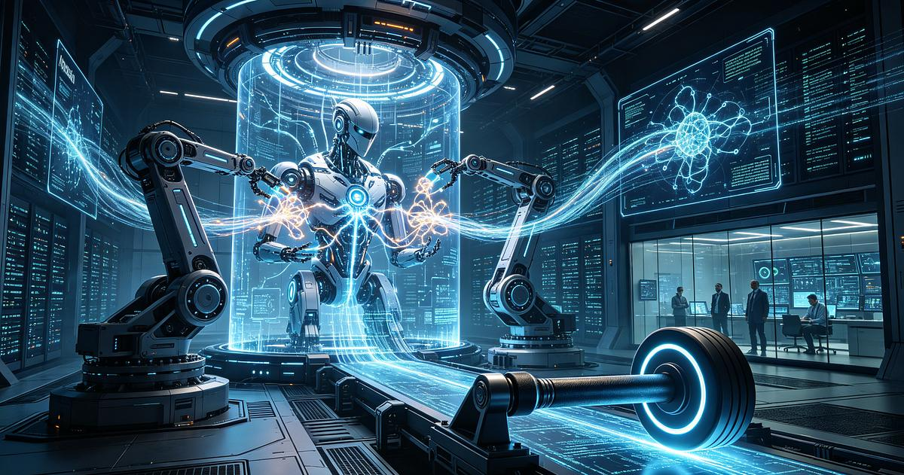
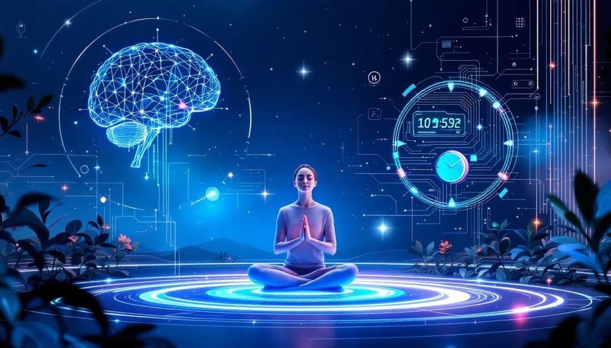

 

<!-- HERO -->

 

 

  

---

01 — THE MIND BEHIND THE MACHINES

# BEYOND THE SCREEN. INTO THE PHYSICAL WORLD.

<table>
<tr>
<td width="62%" valign="top">

### Kevin Varghese

Computer Science undergraduate at **Sree Chitra Thirunal College of Engineering, Trivandrum**.

I explore the intersection of **Artificial Intelligence, Robotics and intelligent physical systems**.

My interest lies in building systems that can perceive their environment, learn from data, adapt to changing conditions and interact meaningfully with the real world.

**What drives my work**

- Embodied AI and intelligent robotics
- Adaptive AI for healthcare and rehabilitation
- Machine Learning and Computer Vision
- Human–robot interaction and safe autonomy

</td>
<td width="38%" valign="middle" align="center">

  

THINK / ENGINEER / CREATE

</td>
</tr>
</table>

---

02 — FLAGSHIP RESEARCH

# THE PROJECT THAT DEFINES MY DIRECTION

### ORTHOSIS / 001

**AI-Powered Adaptive Rehabilitation Orthosis**

An intelligent wearable rehabilitation system designed to analyse gait patterns and estimate the assistance required during movement.

The project combines motion sensing and temporal deep learning to explore personalised rehabilitation support.

| SYSTEM COMPONENT | TECHNOLOGY |
|:--|:--|
| Motion sensing | BNO085 IMU |
| Temporal modelling | CNN–LSTM |
| Movement analysis | Gait features |
| Physical integration | Adaptive orthosis prototype |

`EMBODIED AI` · `HEALTHCARE ROBOTICS` · `ADAPTIVE INTELLIGENCE`

---

03 — PROJECT ARCHIVE

# EXPERIMENTS IN INTELLIGENCE

DIFFERENT DOMAINS. ONE ENGINEERING MINDSET.

<table>
<tr>
<td width="50%" valign="top">

### 002 / VIRO

**Human–Virus Protein Interaction Prediction**

An ML-based system for predicting protein interactions using biological sequence features and Random Forest classification.

`BIOINFORMATICS` `UNIPROT` `MACHINE LEARNING`

<a href="https://github.com/KevinVargheseKV">VIEW PROJECT ↗</a>

</td>
<td width="50%" valign="top">

### 003 / CALM MIND

**AI-Assisted Mental Wellness**

An AI-powered mental wellness project focused on accessible self-help resources and guided conversational support.

`GENERATIVE AI` `NLP` `PYTHON`

<a href="https://github.com/KevinVargheseKV">VIEW PROJECT ↗</a>

</td>
</tr>
</table>

---

04 — TECHNICAL DNA

# THE ENGINEERING STACK

<table>
<tr>
<td width="50%" align="center" valign="top">

**ARTIFICIAL INTELLIGENCE**

Machine Learning · Deep Learning · Computer Vision · NLP

</td>
<td width="50%" align="center" valign="top">

**ROBOTICS & EMBEDDED**

Embedded Systems · Sensor Integration · Robotics

</td>
</tr>
<tr>
<td width="50%" align="center" valign="top">

**DEVELOPMENT**

Software Engineering · Prototyping · Version Control

</td>
<td width="50%" align="center" valign="top">

**RESEARCH INTERESTS**

`EMBODIED AI`

`ADAPTIVE SYSTEMS`

`ASSISTIVE ROBOTICS`

`HUMAN–ROBOT INTERACTION`

</td>
</tr>
</table>

---

05 — EXPERIENCE & LEADERSHIP

# BEYOND THE WORKBENCH

| DOMAIN | EXPERIENCE |
|:--|:--|
| INDUSTRY | **AI/ML Intern** — Safcurl Tech Pvt. Ltd. |
| EDUCATION | **Computer Instructor** — Sprint Comp Education |
| IEEE RAS | **Chair** — IEEE RAS SCT Chapter |
| IEEE RAS | **Student Representative** — IEEE RAS Kerala Chapter |

---

06 — DEVELOPMENT TELEMETRY

# GITHUB COMMAND CENTER

 

 

---

07 — CONTRIBUTION FOOTPRINT

# EVERY COMMIT LEAVES A TRACE.

---

### THE FUTURE OF INTELLIGENCE IS EMBODIED.

**Think deeper. Build smarter. Create impact.**

KEVIN VARGHESE / AI × ROBOTICS × RESEARCH

 

<a href="https://github.com/KevinVargheseKV">GITHUB</a>
&nbsp; · &nbsp;
<a href="https://www.linkedin.com/in/kevin-varghese-063967340/">LINKEDIN</a>

